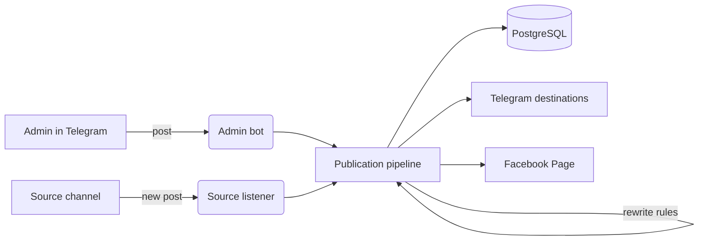

# tg-crosspost-bot

A Telegram bot that publishes one post to many places and relays new posts from a source channel into your own channel. You send a post to the bot once, and it goes to every Telegram group and channel you connected and to your Facebook Page. Separately, the bot watches a source channel and copies each new post into your channel, rewriting contacts and links by rules you define.

> **Status:** design and documentation are done, implementation is in progress. The [roadmap](docs/roadmap.md) shows what is built and what is next.

## Features

**Publishing**
- Send a text, photo, video, document or album to the bot, preview it, and publish it to all connected destinations or to a chosen subset.
- Destinations: Telegram groups and channels where the bot is an administrator, and a Facebook Page through the Graph API.
- Every publication is stored with its per-destination result, so a failed destination can be retried without posting twice to the others.

**Relaying**
- Watch a source channel and copy each new post into one or more target channels, without the "Forwarded from" header.
- Rewrite rules applied before posting: replace phone numbers, usernames and links, append a footer, drop posts by keyword.
- Albums are relayed as albums; edits and deletions in the source are mirrored to the copy.

**Operations**
- Management through an admin bot: destinations, relay routes, rules and a publication log.
- Rate limiting and automatic retries on Telegram flood limits and Facebook errors.
- Runs as a single Docker container next to PostgreSQL.

## How it works

Both entry points produce the same internal post model. The pipeline applies rewrite rules, stores the publication and dispatches it to each destination through its own adapter with its own rate limit. More detail is in [docs/architecture.md](docs/architecture.md).

## Stack

Node.js 22, TypeScript, NestJS, grammY for the Bot API, GramJS for the Telegram client API (MTProto), Prisma on PostgreSQL, the Facebook Graph API for Page posts. Vitest for tests, Docker for deployment, GitHub Actions for CI.

## Platform constraints

These shape the design and are worth knowing before you deploy:

- **Facebook groups are not supported.** Meta shut down the Groups API in April 2024, so third-party apps can no longer publish to groups. The bot publishes to Facebook Pages only. Automating a personal Facebook account to post in groups breaks Meta's terms and gets accounts blocked, so this project does not do it.
- **A bot only sees channels where it is an administrator.** To relay from a channel you do not administer, the bot needs a Telegram user session (a separate account is recommended). See [docs/platform-notes.md](docs/platform-notes.md).
- **Telegram flood limits** apply per chat and globally; the bot queues and paces messages instead of failing.

## Responsible use

Relay content only from sources you own or have permission to repost. Rewrite rules exist to adapt your own content across your channels, not to pass off someone else's posts as yours.

## Documentation

| Document | What it covers |
| --- | --- |
| [docs/architecture.md](docs/architecture.md) | Modules, message flow, error handling |
| [docs/data-model.md](docs/data-model.md) | Database schema |
| [docs/platform-notes.md](docs/platform-notes.md) | Telegram and Facebook limits and pitfalls |
| [docs/configuration.md](docs/configuration.md) | Environment variables and setup of tokens |
| [docs/roadmap.md](docs/roadmap.md) | Milestones and tickets |
| [docs/specs/](docs/specs) | One spec per ticket |

## License

[MIT](LICENSE)
