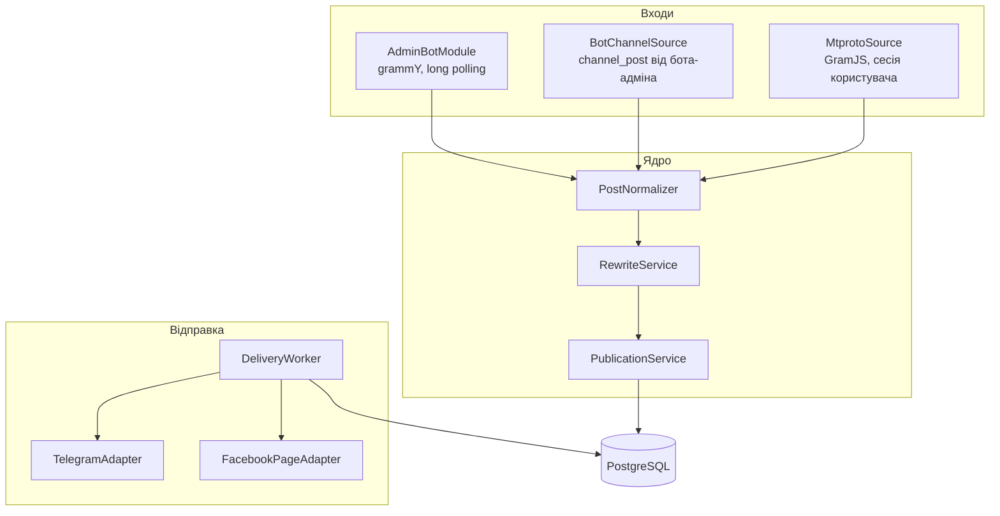

# Архітектура

Документ описує, з яких частин складається бот, як пост проходить від входу до публікації і як обробляються помилки. Схема бази — у [data-model.md](data-model.md), обмеження платформ — у [platform-notes.md](platform-notes.md).

## Загальна схема



Один процес Node.js, один застосунок NestJS. Бот працює через long polling, тому для запуску не потрібні домен і вебхук. Відправка відокремлена від прийому: вхід лише записує публікацію і доставки в базу, а воркер забирає доставки зі статусом `PENDING` і відправляє їх. Через це перезапуск не губить пости, а повтор невдалої доставки не дублює вдалі.

## Модулі

| Модуль | Відповідальність |
| --- | --- |
| `ConfigModule` | Читає змінні середовища і валідує їх на старті; без обов'язкових змінних застосунок не запускається. |
| `PrismaModule` | `PrismaService` для доступу до бази. |
| `AdminBotModule` | Адмін-бот: доступ лише для `ADMIN_IDS`, меню, створення поста, керування напрямками, маршрутами і правилами, журнал. |
| `DestinationsModule` | Реєстр напрямків. Ловить `my_chat_member`, коли бота додають адміністратором у групу чи канал, і пропонує адміну зареєструвати напрямок. |
| `SourcesModule` | Джерела для перенесення: `BotChannelSource` (бот — адмін у каналі-джерелі) і `MtprotoSource` (чужий публічний канал через сесію користувача). |
| `PostsModule` | Внутрішня модель поста `PostDraft` і нормалізатори з повідомлення grammY та з повідомлення GramJS. |
| `RewriteModule` | Правила переписування: чисті функції без звернень до мережі, повністю покриті юніт-тестами. |
| `PublicationModule` | Створює `Post` і по одній `Delivery` на кожен напрямок у транзакції. |
| `DeliveryModule` | Воркер відправки, пейсинг, повтори, адаптери напрямків. |

## Внутрішня модель поста

Усі входи зводяться до одного типу, і далі ядро не знає, звідки прийшов пост.

```ts
type PostDraft = {
  text: string;                 // текст або підпис до медіа
  entities: MessageEntity[];    // форматування Telegram, зсуви в UTF-16
  media: PostMedia[];           // 0 — текстовий пост, 1 — одиночне медіа, 2–10 — альбом
};

type PostMedia = {
  kind: 'photo' | 'video' | 'document' | 'animation';
  telegramFileId?: string;      // якщо медіа вже доступне боту
  buffer?: Buffer;              // якщо медіа завантажене через MTProto
  fileName?: string;
  mimeType?: string;
};
```

## Шлях поста

### Ручна публікація

1. Адмін надсилає боту пост (текст, медіа або альбом). Альбом приходить кількома оновленнями з однаковим `media_group_id`, тому `AlbumBuffer` збирає їх і передає далі одним постом.
2. `PostNormalizer` будує `PostDraft`.
3. Бот показує прев'ю і клавіатуру з напрямками: усі увімкнені позначені, адмін може зняти позначку.
4. Після підтвердження `PublicationService` у транзакції створює `Post` і `Delivery` для кожного обраного напрямку зі статусом `PENDING`.
5. `DeliveryWorker` відправляє доставки, записує зовнішні id повідомлень і статус. Адмін отримує підсумок: куди вийшло, куди ні і чому.

### Перенесення з каналу

1. Джерело отримує новий пост (`channel_post` для бота, `NewMessage` для GramJS) і, якщо це альбом, проводить його через `AlbumBuffer`.
2. Для кожного увімкненого маршруту з цього джерела перевіряється унікальність пари «маршрут + ключ поста в джерелі», щоб повторне оновлення після перезапуску не створило дубль.
3. `RewriteService` застосовує правила маршруту по порядку. Правило `SKIP_IF_CONTAINS` може відкинути пост цілком.
4. Далі так само: `Post`, `Delivery`, воркер.

Редагування в джерелі шукає вже опубліковані копії через `Delivery.externalIds` і редагує їх. Видалення працює лише для MTProto-джерела: Bot API не повідомляє бота про видалені пости каналу.

## Відправка і повтори

- Воркер запускається кожні кілька секунд через `@nestjs/schedule` і бере пачку доставок `PENDING` з `nextAttemptAt <= now()`, блокуючи рядки (`FOR UPDATE SKIP LOCKED`), щоб два воркери не взяли одну доставку.
- Кожен адаптер має власний пейсинг: для Telegram — не частіше одного повідомлення на секунду в один чат і не більше двадцяти на хвилину в групу.
- Помилка класифікується адаптером:
  - тимчасова (429 з `retry_after`, мережеві помилки, 5xx) — `attempts + 1`, `nextAttemptAt` за `retry_after` або експоненційною затримкою; після `MAX_ATTEMPTS` — `FAILED`;
  - постійна (бота видалили з чату — 403, чат не знайдено, недійсний токен Facebook — код 190) — одразу `FAILED`, напрямок вимикається, адмін отримує повідомлення.
- Альбом у Telegram — один виклик `sendMediaGroup`, тому одна доставка може мати кілька зовнішніх id; вони зберігаються масивом.

## Адаптери напрямків

```ts
interface DestinationAdapter {
  publish(post: PostDraft, destination: Destination): Promise<ExternalRef[]>;
  edit(post: PostDraft, refs: ExternalRef[], destination: Destination): Promise<void>;
  remove(refs: ExternalRef[], destination: Destination): Promise<void>;
}
```

- `TelegramAdapter`: текст — `sendMessage` з `entities`; одиночне медіа — `sendPhoto` / `sendVideo` / `sendDocument` за `file_id` або з буфера; альбом — `sendMediaGroup`. `copyMessage` використовується, лише коли пост не змінювався правилами: він не дає замінити текст текстового повідомлення.
- `FacebookPageAdapter`: текст — `/{page-id}/feed`; одне фото — `/{page-id}/photos` з `caption`; кілька фото — кожне завантажується з `published=false`, потім один пост у `/feed` з `attached_media`; відео — `/{page-id}/videos`. Форматування Telegram переводиться в простий текст, посилання з `text_link` дописуються після тексту в дужках.

## Безпека

- Адмін-бот відповідає лише користувачам з `ADMIN_IDS`; решті — мовчить.
- Токени і сесія MTProto — лише у змінних середовища, не в базі і не в логах.
- Логи пишуть id чатів і повідомлень, але не текст постів.

## Тести

- Юніт: правила переписування і перерахунок `entities`, нормалізатори, класифікація помилок адаптерів, `AlbumBuffer` з фейковим таймером.
- Інтеграційні: `PublicationService` і воркер на тестовій базі PostgreSQL з фейковими адаптерами.
- Мережа Telegram і Facebook у тестах не викликається.
